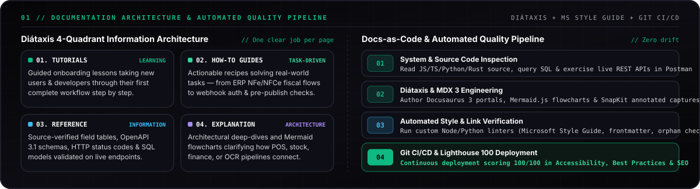
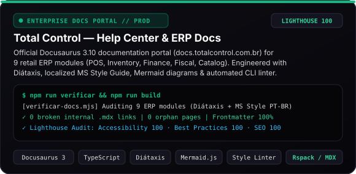
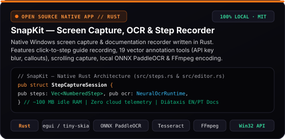
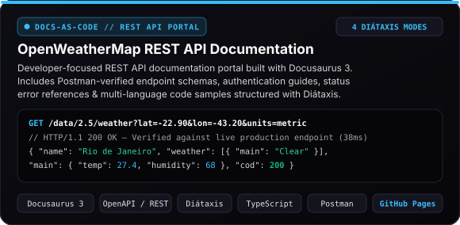
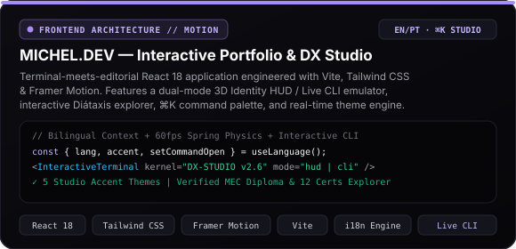
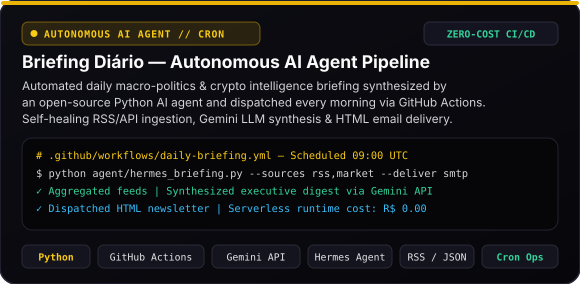
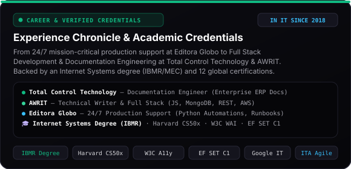
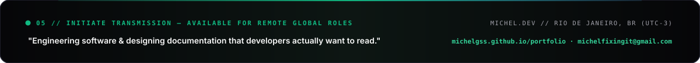

<!-- MICHEL.DEV // DX-STUDIO GITHUB PROFILE MONOLITH -->

<div align="center">

  <!-- HERO MONOLITH HUD (Matches https://michelgss.github.io/portfolio/) -->
  <a href="https://michelgss.github.io/portfolio/">
    
  </a>

  <br/>

  <!-- ANIMATED TERMINAL TYPING LINE -->
  <a href="https://michelgss.github.io/portfolio/">
    
  </a>

  <!-- QUICK ACTION & SOCIAL PROOF BAR -->
  <p align="center">
    <a href="https://michelgss.github.io/portfolio/">
      
    </a>
    <a href="https://docs.totalcontrol.com.br/">
      
    </a>
    <a href="https://github.com/MichelGSS/snapkit/releases/latest">
      
    </a>
    <a href="https://michelgss.github.io/portfolio/resume.pdf">
      
    </a>
    <a href="https://www.linkedin.com/in/michelthedev">
      
    </a>
    <a href="mailto:michelfixingit@gmail.com">
      
    </a>
    
  </p>

</div>

---

### `01 // MANIFESTO & ARCHITECTURE`

<p align="center">
  <a href="https://michelgss.github.io/portfolio/#about">
    
  </a>
</p>

```yaml
kernel:      "MICHEL.DEV // DX-STUDIO v2.6.0"
identity:    "Michel Silveira — Full Stack Developer & Documentation Engineer (DX)"
base:        "Rio de Janeiro, Brazil (UTC-3) · Remote Worldwide"
languages:   ["Portuguese (Native)", "English (C1 Advanced — EF SET 68/100)"]
current_ops:
  - role:    "Documentation Engineer @ Total Control Technology"
    scope:   "Docusaurus 3.10 ERP Help Center (docs.totalcontrol.com.br), Diátaxis, MS Style Guide, CLI Linter, Lighthouse 100"
  - role:    "Technical Writer & Full Stack Developer @ AWRIT"
    scope:   "JavaScript, MongoDB, Tailwind CSS, REST APIs, AWS, SQL verification & Docs-as-Code"
  - project: "Creator of SnapKit (Open-Source Native Rust Desktop App)"
    scope:   "100% local screen capture, 19 annotation tools, scrolling capture, step-by-step guide recorder & ONNX/PaddleOCR"
education:   "Technologist Degree in Internet Systems — Centro Universitário IBMR (MEC Recognized)"
philosophy:  "Read the source, run the endpoints, automate the style linter, and ship docs that match how the software truly behaves."
```

---

### `02 // CAPABILITY MATRIX & TOOLCHAIN`

<div align="center">

  <p>
    
  </p>

  <p>
    
    
    
    
    
    
    
    
    
  </p>

</div>

---

### `03 // SELECTED WORKS & PRODUCTION CASE STUDIES`

<table width="100%">
  <tr>
    <td width="50%" valign="top">
      <a href="https://docs.totalcontrol.com.br/">
        
      </a>
      <p align="center">
        <sub>
          <a href="https://docs.totalcontrol.com.br/"><b>🚀 Live Production Portal (docs.totalcontrol.com.br)</b></a>
          &nbsp;·&nbsp;
          <a href="https://michelgss.github.io/portfolio/#samples"><b>🔍 Case Study on Portfolio</b></a>
        </sub>
      </p>
    </td>
    <td width="50%" valign="top">
      <a href="https://github.com/MichelGSS/snapkit">
        
      </a>
      <p align="center">
        <sub>
          <a href="https://github.com/MichelGSS/snapkit"><b>📂 Source Architecture (Rust)</b></a>
          &nbsp;·&nbsp;
          <a href="https://github.com/MichelGSS/snapkit/releases/latest"><b>📦 Download Windows Installer</b></a>
        </sub>
      </p>
    </td>
  </tr>
  <tr>
    <td width="50%" valign="top">
      <a href="https://michelgss.github.io/openweather-docs/">
        
      </a>
      <p align="center">
        <sub>
          <a href="https://michelgss.github.io/openweather-docs/"><b>🚀 Live API Docs Portal</b></a>
          &nbsp;·&nbsp;
          <a href="https://github.com/MichelGSS/openweather-docs"><b>📂 Source Repository</b></a>
        </sub>
      </p>
    </td>
    <td width="50%" valign="top">
      <a href="https://michelgss.github.io/portfolio/">
        
      </a>
      <p align="center">
        <sub>
          <a href="https://michelgss.github.io/portfolio/"><b>🚀 Launch Interactive DX Studio</b></a>
          &nbsp;·&nbsp;
          <a href="https://github.com/MichelGSS/portfolio"><b>📂 Source Repository</b></a>
        </sub>
      </p>
    </td>
  </tr>
  <tr>
    <td width="50%" valign="top">
      <a href="https://github.com/MichelGSS/hermes-briefing-diario">
        
      </a>
      <p align="center">
        <sub>
          <a href="https://github.com/MichelGSS/hermes-briefing-diario"><b>📂 Inspect Autonomous Agent &amp; Cron Workflow</b></a>
        </sub>
      </p>
    </td>
    <td width="50%" valign="top">
      <a href="https://michelgss.github.io/portfolio/#certifications">
        
      </a>
      <p align="center">
        <sub>
          <a href="https://michelgss.github.io/portfolio/#experience"><b>💼 Full Career Timeline</b></a>
          &nbsp;·&nbsp;
          <a href="https://michelgss.github.io/portfolio/#certifications"><b>🎓 Verify MEC Diploma &amp; 12 Certifications</b></a>
        </sub>
      </p>
    </td>
  </tr>
</table>

---

### `04 // LIVE ENGINEERING TELEMETRY (LOWLIGHTER/METRICS)`

<div align="center">

  <!-- LOWLIGHTER/METRICS DUAL TELEMETRY DASHBOARD -->
  <p align="center">
    
    
  </p>

  <!-- CONTRIBUTION GRAPH SNAKE -->
  <p align="center">
    <picture>
      <source media="(prefers-color-scheme: dark)" srcset="https://raw.githubusercontent.com/MichelGSS/MichelGSS/output/github-snake-dark.svg" />
      <source media="(prefers-color-scheme: light)" srcset="https://raw.githubusercontent.com/MichelGSS/MichelGSS/output/github-snake.svg" />
      
    </picture>
  </p>

</div>

---

### `05 // INITIATE TRANSMISSION`

<div align="center">

  <a href="https://michelgss.github.io/portfolio/#contact">
    
  </a>

  <br/><br/>

  <p align="center">
    <a href="https://michelgss.github.io/portfolio/"><b>🌐 Portfolio (EN/PT)</b></a>
    &nbsp;·&nbsp;
    <a href="https://michelgss.github.io/portfolio/resume.pdf"><b>📄 Resume (EN)</b></a>
    &nbsp;·&nbsp;
    <a href="https://michelgss.github.io/portfolio/resume-pt.pdf"><b>📄 Currículo (PT-BR)</b></a>
    &nbsp;·&nbsp;
    <a href="https://www.linkedin.com/in/michelthedev"><b>💼 LinkedIn (/in/michelthedev)</b></a>
    &nbsp;·&nbsp;
    <a href="mailto:michelfixingit@gmail.com"><b>✉️ michelfixingit@gmail.com</b></a>
  </p>

</div>
