<!-- Header -->
<p align="center">
  
</p>

<p align="center">
  <a href="https://michelgss.github.io/portfolio/">
    
  </a>
</p>

<p align="center">
  <a href="https://michelgss.github.io/portfolio/"></a>
  <a href="https://www.linkedin.com/in/michelthedev"></a>
  <a href="mailto:michelfixingit@gmail.com"></a>
  
</p>

---

### `$ cat about.md`

```yaml
name:       Michel Silveira
role:       [Software Developer, Technical Writer]
location:   Rio de Janeiro, Brazil
languages:  [Portuguese, English]
currently:
  - writing docs for the Total ON ecosystem
  - building small tools that run themselves (GitHub Actions + AI agents)
approach:   "If it isn't documented, it doesn't exist."
fun_fact:   I actually read the README. Sometimes I get paid to write it.
```

### `$ ls ./stack`

<p align="center">
  
</p>
<p align="center">
  
</p>

<p align="center">
  <b>Docs toolbox</b><br/><br/>
  
  
  
  
  
</p>

### `$ ls ./projects --featured`

<table>
  <tr>
    <td width="50%" valign="top">
      <h4>📘 <a href="https://michelgss.github.io/openweather-docs/">OpenWeatherMap API Docs</a></h4>
      Developer-focused docs for the OpenWeatherMap REST API, organized with the Diátaxis framework: tutorials, how-to guides, reference and explanation.<br/><br/>
      
      
      <br/><sub><a href="https://github.com/MichelGSS/openweather-docs">source</a> · <a href="https://michelgss.github.io/openweather-docs/">live site</a></sub>
    </td>
    <td width="50%" valign="top">
      <h4>🗞️ <a href="https://github.com/MichelGSS/hermes-briefing-diario">Briefing Diário</a></h4>
      A daily politics &amp; crypto briefing written by an open-source AI agent and emailed every morning by GitHub Actions. Runs on its own, costs R$ 0.<br/><br/>
      
      
      
      <br/><sub><a href="https://github.com/MichelGSS/hermes-briefing-diario">source</a></sub>
    </td>
  </tr>
  <tr>
    <td width="50%" valign="top">
      <h4>💼 <a href="https://michelgss.github.io/portfolio/">Portfolio</a></h4>
      My personal site: dark, terminal-inspired, editorial typography, in English and Portuguese.<br/><br/>
      
      
      
      <br/><sub><a href="https://github.com/MichelGSS/portfolio">source</a> · <a href="https://michelgss.github.io/portfolio/">live site</a></sub>
    </td>
    <td width="50%" valign="top">
      <h4>🎨 <a href="https://github.com/MichelGSS/PixelMinimal">PixelMinimal</a></h4>
      A minimalist pixel-art editor: adjustable grid, a color per mouse button, and click-and-drag drawing.<br/><br/>
      
      
      
      <br/><sub><a href="https://github.com/MichelGSS/PixelMinimal">source</a></sub>
    </td>
  </tr>
</table>

### `$ git log --stats`

<p align="center">
  
</p>

<p align="center">
  <picture>
    <source media="(prefers-color-scheme: dark)" srcset="https://raw.githubusercontent.com/MichelGSS/MichelGSS/output/github-snake-dark.svg" />
    <source media="(prefers-color-scheme: light)" srcset="https://raw.githubusercontent.com/MichelGSS/MichelGSS/output/github-snake.svg" />
    
  </picture>
</p>

<!-- Footer -->
<p align="center">
  
</p>
